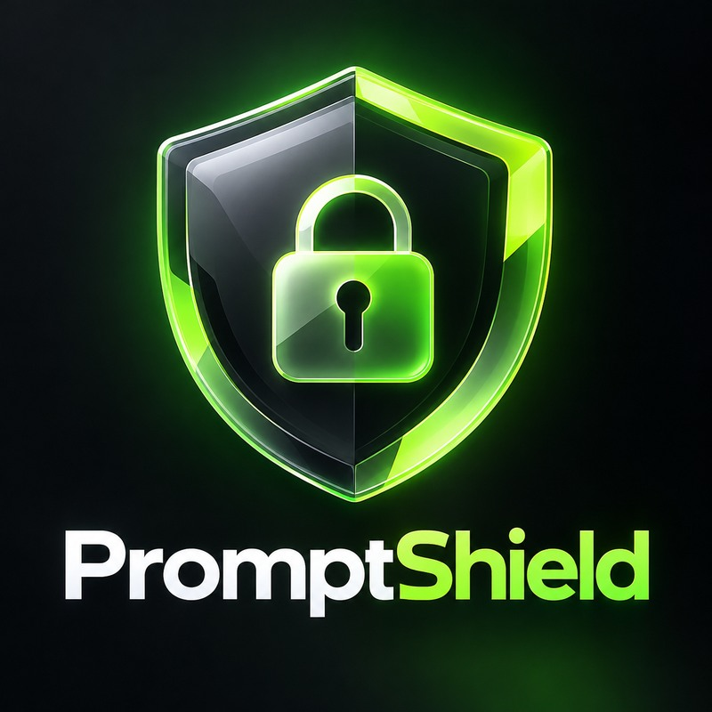
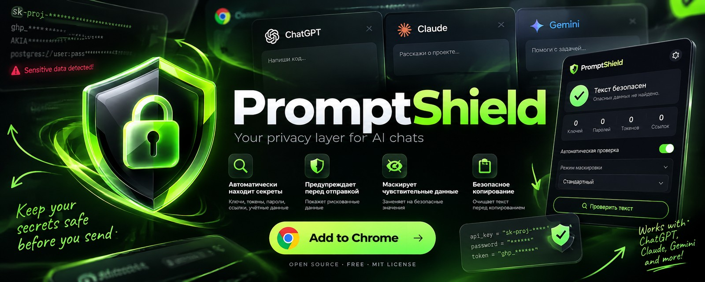

<div align="center">
  
  <h1>PromptShield</h1>
  <p><strong>Catch possible secrets before you paste them into AI chats.</strong></p>
  <p>A lightweight, local-first Chrome extension that scans prompts for common credential patterns and helps redact matches before you share them.</p>
  <p>
    
    
    
    
  </p>
</div>

---

<div align="center">
  
  <sub>Brand concept artwork, not a Chrome Web Store listing or a screenshot of a production release.</sub>
</div>

## Why PromptShield?

It is easy to paste a stack trace or code sample into an AI chat and accidentally include a token, password, or connection string. PromptShield adds a small checkpoint: scan the text, review possible matches, and redact them before sharing.

**The core idea:** the scan runs in your browser. No PromptShield account, remote AI API, or PromptShield backend is required.

## ✨ Features

- **Local pattern scanning** for common credential formats, including OpenAI-style keys, GitHub tokens, AWS access-key IDs, Slack tokens, Stripe live secret keys, Google API keys, bearer tokens, private keys, credential assignments, and database connection strings.
- **Reviewable findings** with masked previews, so the full detected value is not shown in the results list.
- **One-click redaction** that replaces detected spans with descriptive markers such as `[REDACTED_OPENAI_STYLE_API_KEY]`.
- **Safer copying** that rescans the current text and redacts known matches before copying it.
- **Experimental send warnings** on supported AI chat pages, where website UI behavior permits interception.
- **No build step** for this MVP — load the extension directly from its source folder.

> [!WARNING]
> PromptShield is an experimental privacy helper, not a guarantee that a prompt is safe. Pattern matching can miss secrets and can flag harmless examples. Always review sensitive text yourself before sending it.

## 🚀 Install locally

The extension is currently installed from source; it is **not** being distributed through the Chrome Web Store.

1. Download this repository as a ZIP and extract it, or clone it:
   ```bash
   git clone https://github.com/YOUR-USERNAME/promptshield.git
   ```
2. Open `chrome://extensions` in Chrome or another Chromium-based browser.
3. Turn on **Developer mode**.
4. Click **Load unpacked**.
5. Select the extracted `promptshield` project folder — the one containing `manifest.json`.
6. Click the PromptShield toolbar icon, paste **synthetic test text**, and choose **Scan prompt**.
7. To try the experimental website warning, reload a supported AI chat tab after installing the extension.

Replace `YOUR-USERNAME` with the GitHub account that hosts the repository.

## 🧪 Try the scanner

Use fake data only. For example:

```text
api_key = "sk-proj-abcdefghijklmnopqrstuvwxyz123456"
```

PromptShield should flag a matching pattern and offer to redact it. Never paste a real credential into a demo, issue, test fixture, or screenshot.

### Run tests

Requires Node.js; no package installation is needed.

```bash
node tests/scanner.test.js
```

The current scanner test suite contains nine checks covering detection, ordinary text, overlapping matches, and redaction. Passing these tests validates the scanner fixtures only — it does **not** prove that website interception is reliable.

## 🌐 Supported sites

The current content script is configured for:

- ChatGPT — `chatgpt.com` and `chat.openai.com`
- Claude — `claude.ai`
- Gemini — `gemini.google.com`

Website interfaces change often. The warning mechanism is experimental and may not catch every click, keyboard shortcut, send method, or future UI update.

## 🔐 Privacy model

- Pattern scanning runs locally in the extension.
- PromptShield does not send prompt text to a PromptShield server.
- Results are not a substitute for secret rotation, secure credential storage, or organization-wide data-loss-prevention controls.
- Use the minimum permissions and inspect the source before installing any browser extension.
- Use only synthetic credentials when testing or reporting issues.

See [SECURITY.md](SECURITY.md) for responsible security-reporting guidance.

## 🧱 Project structure

```text
promptshield/
├── assets/
│   ├── promptshield-banner.jpg
│   └── promptshield-logo.jpg
├── icons/
├── tests/
│   └── scanner.test.js
├── .github/
│   └── ISSUE_TEMPLATE/
├── manifest.json
├── scanner.js       # Local detection and redaction rules
├── popup.html       # Extension popup interface
├── popup.css        # Dark, glass-inspired styling
├── popup.js         # Popup interactions
├── content.js       # Experimental AI-site warnings
├── content.css      # Warning panel styles
├── CHANGELOG.md
├── CONTRIBUTING.md
├── SECURITY.md
├── LICENSE
└── README.md
```

## 🗺️ Roadmap

- [x] Local scanning and redaction MVP
- [x] Chrome Manifest V3 extension scaffold
- [x] Initial scanner tests and contributor/security docs
- [ ] Test interception flows manually on every supported site
- [ ] Add user-editable detection rules and sensitivity settings
- [ ] Add more synthetic test fixtures and regression coverage
- [ ] Publish a real, verified demo GIF and screenshots
- [ ] Evaluate Firefox support

## 🤝 Contributing

Bug reports, ideas, and pull requests are welcome. Please read [CONTRIBUTING.md](CONTRIBUTING.md) first. Include reproduction steps and test new detection rules with synthetic values only.

If you find a security issue, follow [SECURITY.md](SECURITY.md) instead of posting real credentials publicly.

## 📄 License

PromptShield is released under the [MIT License](LICENSE).

---

<div align="center">
  <strong>Think before you share. Scan before you send. 🛡️</strong><br />
  <sub>Built as an open-source experiment for safer AI workflows.</sub>
</div>
